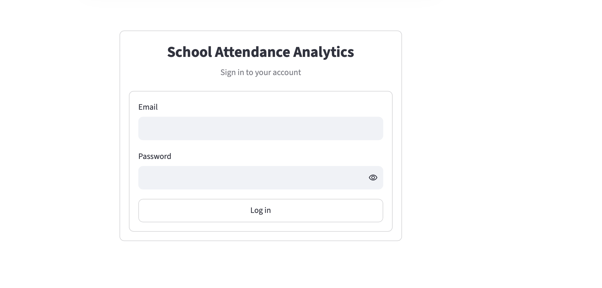
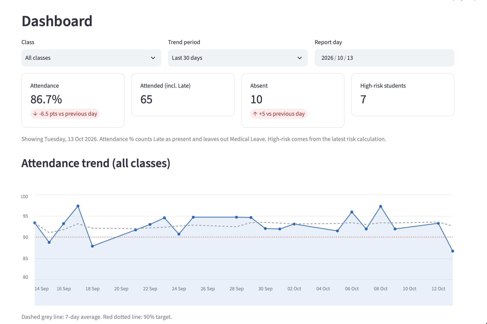
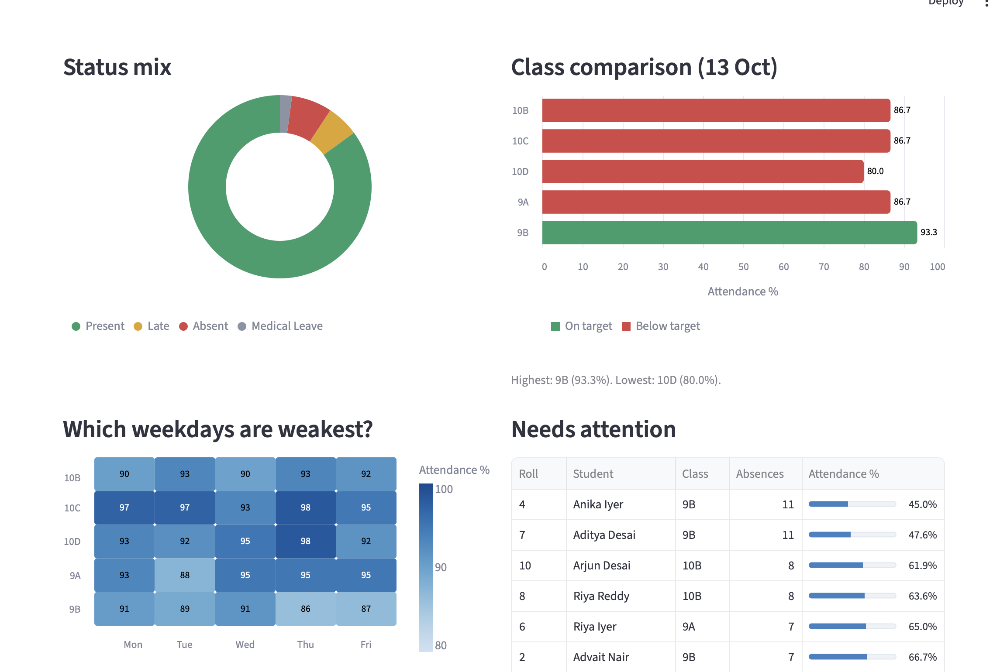
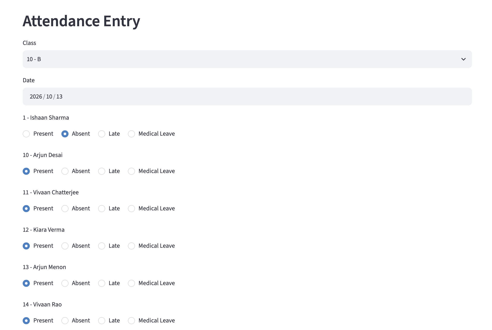
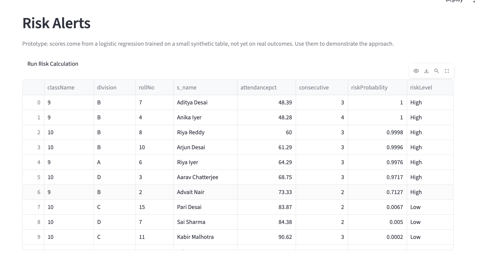
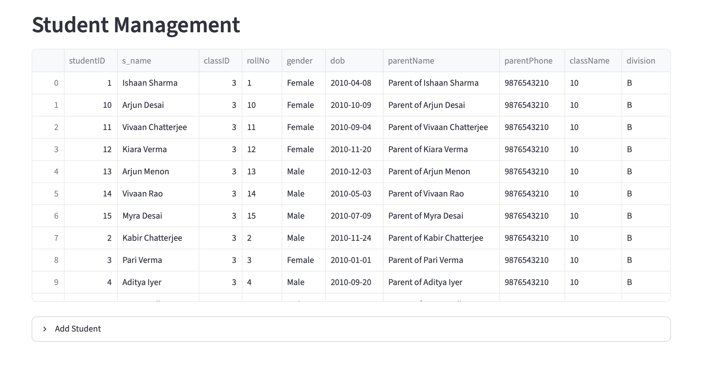

# School Attendance Analytics System

A web application for recording school attendance, analysing it, and flagging students who may be at risk of chronic absenteeism so that teachers can follow up early.

> **All student data in this repository is simulated.** `seed.py` generates random names and attendance for demonstration. No real student information is used.

## Screenshots
**Login**


**Dashboard**


**Dashboard charts**


**Attendance entry**


**Risk alerts**


**Students management**



## Features

- **Teacher login** with bcrypt-hashed passwords
- **Student management:** view all students and add new ones, with input validation
- **Attendance entry** per class and date, with four statuses (see below). Re-saving a date updates the existing records
- **Dashboard** with class and date filters, KPI cards that compare with the previous day, an attendance trend with a 7-day average and 90% target line, a status mix chart, a class comparison, a class-by-weekday heatmap and a list of students who need attention
- **Risk alerts:** a logistic-regression prototype scores each student's risk (see "How risk scoring works")
- **Reports:** class-wise student list exported to Excel

## Attendance status rules

| Status | Counts as | Why |
|---|---|---|
| Present | Attended | |
| Late | Attended | The student came, only not on time |
| Absent | Not attended | |
| Medical Leave | Excluded from the percentage | Excused absence, so it should not lower the student's rate |

The same rules apply on the dashboard, in the class comparison and in the risk features.

## Tech stack

| Layer | Technology |
|---|---|
| Interface | Streamlit with a custom theme (`.streamlit/config.toml`) and Altair charts |
| Logic | Python, pandas, NumPy |
| Machine learning | scikit-learn (logistic regression) |
| Database | MySQL, accessed with `mysql-connector-python` |
| Security | bcrypt password hashing, parameterised SQL, credentials in environment variables |

## Architecture

The code follows a layered design, so each file has one job:

```
app.py (Streamlit interface)
   |
analytics.py / prediction.py / reports.py (logic)
   |
database.py (all SQL and the connection)
   |
MySQL
```

| File | Purpose |
|---|---|
| `app.py` | Login, dashboard and all pages |
| `analytics.py` | Attendance statistics, trends and dashboard queries |
| `prediction.py` | Feature calculation and risk scoring |
| `reports.py` | Excel  report generation |
| `database.py` | Every SQL query; connection settings come from `.env` |
| `schema.sql` | Creates the database and its five tables |
| `seed.py` | Generates demo data |

## Setup

**Prerequisites:** Python 3.9+, MySQL 8, Git. On macOS: `brew install mysql && brew services start mysql`.

```bash
# 1. Clone
git clone https://github.com/<your-username>/<your-repo>.git
cd <your-repo>

# 2. Virtual environment and dependencies
python3 -m venv .venv
source .venv/bin/activate          # Windows: .venv\Scripts\activate
pip install -r requirements.txt

# 3. Create the database and tables
mysql -u root -p < schema.sql

# 4. Add your MySQL credentials
cp .env.example .env               # then edit .env and set DB_PASSWORD

# 5. Load demo data (run once, on an empty database)
python seed.py

# 6. Start the app
streamlit run app.py
```

The app opens at `http://localhost:8501`.

To start over, run `DROP DATABASE attendance;` in MySQL, then repeat steps 3 and 5.

## Demo logins

These accounts are created by `seed.py` for demonstration only.

| Role | Email | Password |
|---|---|---|
| Administrator | `admin@school.com` | `admin123` |
| Teacher | `priya.sharma@school.com` | `teacher123` |

## How risk scoring works

For each student, `prediction.py` calculates two features from their recent attendance records: the attendance percentage and the longest run of consecutive absences. A logistic regression turns these into a probability between 0 and 1, and students are labelled **High** (0.6 or above), **Medium** (0.3 or above) or **Low**.

**This is a prototype.** The model is trained on a small, hand-made synthetic table, not on real student outcomes, so the scores show how the pipeline works rather than a validated prediction. Replacing `_prototype_model()` with a model trained on real, labelled history is the intended next step.

## Current limitations

- Risk model is a prototype (see above)
- Roles are stored and displayed, but all logged-in users currently see the same pages
- Reports export the student list; date-range attendance reports are not built yet
- Automatic capture of attendance (for example RFID with an ESP32 and MFRC522 reader) is a design idea only, not part of this version

## Author

Bhaumik Panjabi, Pune, India. Built as an internship project.
